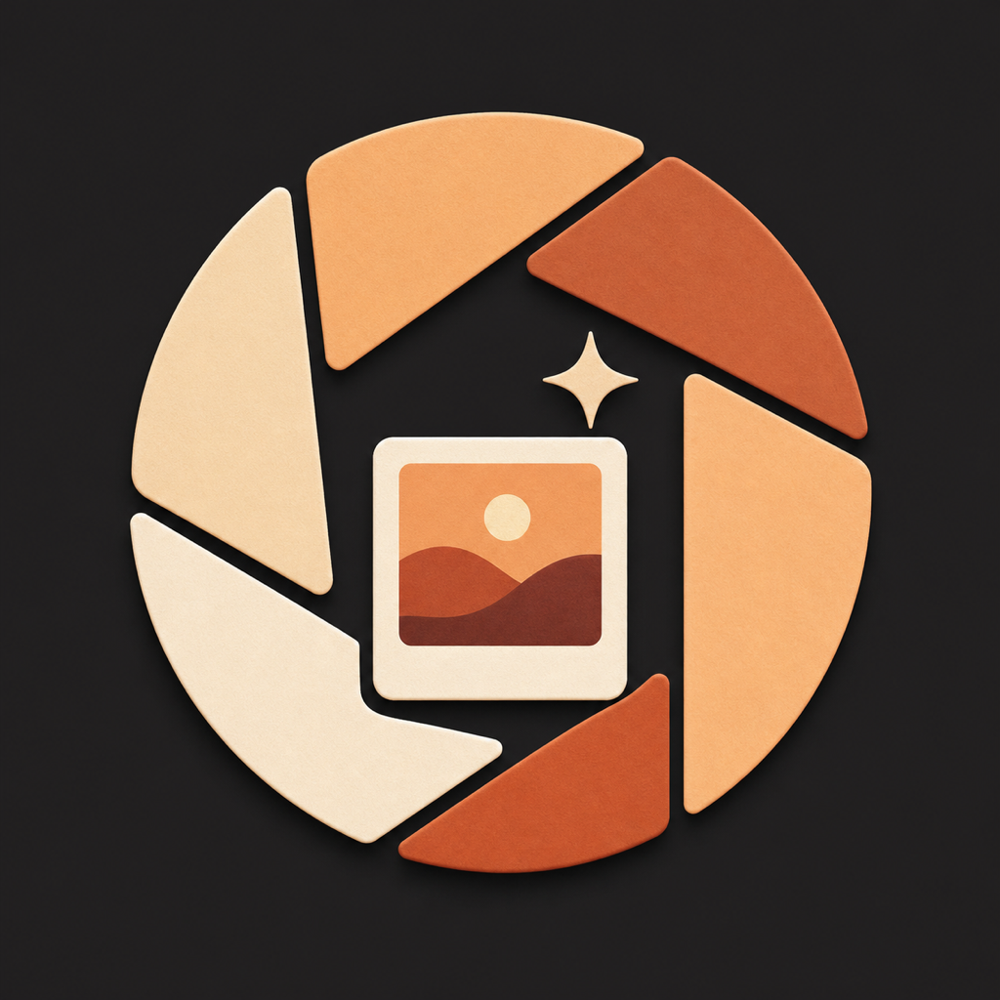
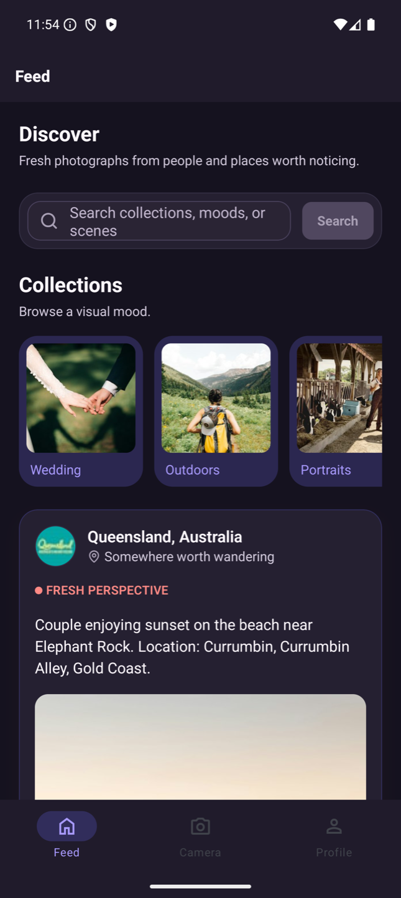
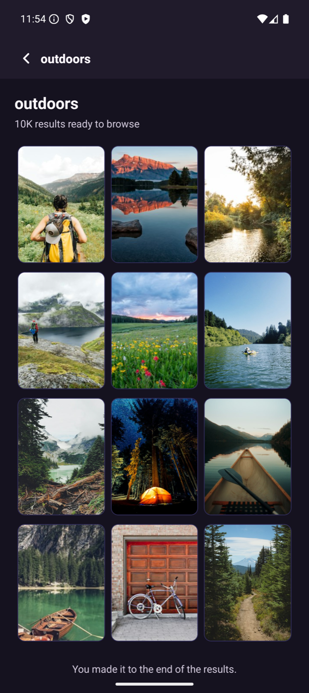
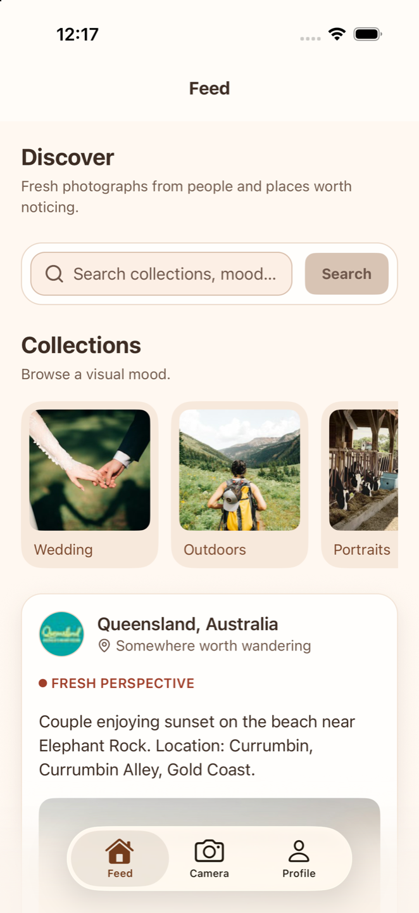
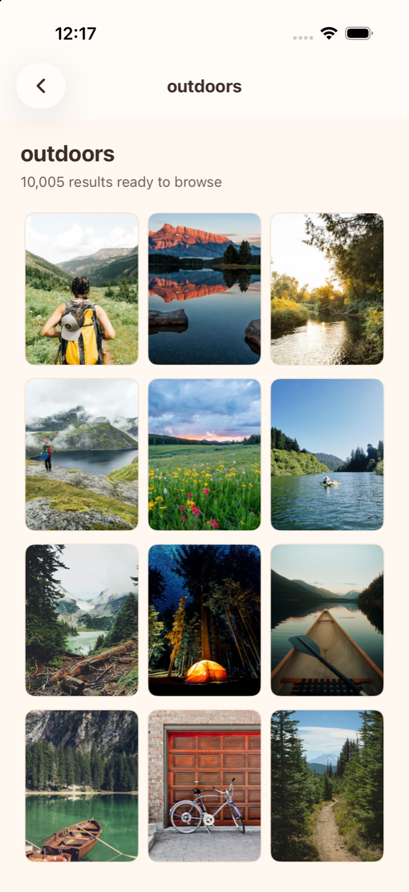
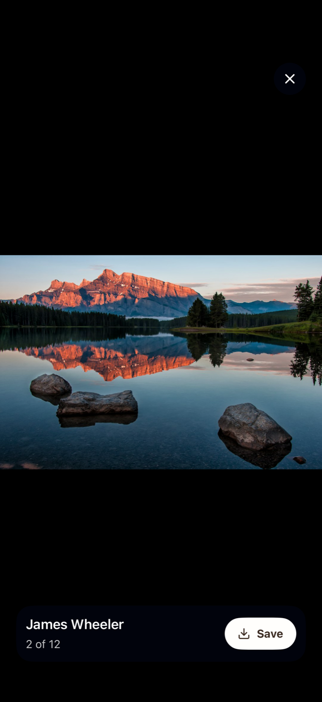

  

# PicXplorer

Discover photography you love and keep a visual journal of your own.

PicXplorer is a photo discovery and journaling app for iOS and Android. Browse photography from Unsplash when you’re looking for inspiration, then use the camera to capture something of your own. Add a caption to remember the story behind it and revisit it in your personal gallery.

## A look inside

### Android

| Discover | Explore a collection |
| :---: | :---: |
|  |  |
| Browse featured photography and pick a theme. | Explore photos on a subject you’re curious about. |

### iOS

| Discover | Explore a collection | View a photo |
| :---: | :---: | :---: |
|  |  |  |
| Browse the feed and find a theme to explore. | Scan a grid of photos from the Outdoors collection. | Open a photo full-screen, see who took it, and save it to your device. |

## What you can do

- **Find inspiration.** Browse the Discover feed or jump into themed collections like travel, portraits, and the outdoors. Search for a subject, mood, or scene of your own.
- **Keep your favorites handy.** Heart photos in the feed to find them again in your Liked tab. Save an image to your device’s photo library when you want a copy.
- **Make a photo journal.** Take a photo, add a short caption, and save it to your gallery. You can edit the caption, share the capture, or remove it later. Your gallery is stored on the device.
- **Make it yours.** Choose English or Spanish and light or dark appearance, or follow your device settings.

Sign in with Google to get started. Discovery photos come from [Unsplash](https://unsplash.com/), with photographer credits shown in the app.

## Run locally

PicXplorer uses Expo SDK 56, React Native, TypeScript, Expo Router, and Unistyles. Use a native development build for iOS or Android.

1. Run `pnpm install`.
2. Add your Unsplash access key to a local `.env` as `EXPO_PUBLIC_UNSPLASH_ACCESS_KEY`. A working build also needs an Auth0 native application with Google sign-in enabled and its domain and client ID configured in the environment.
3. Run `pnpm ios` or `pnpm android` to build and install the development client. Run `pnpm start` to start Metro for an installed client.

Run `pnpm check` for type checking and linting. Native projects are generated locally through Expo Continuous Native Generation. The [EAS configuration](eas.json) defines development and production build profiles.
